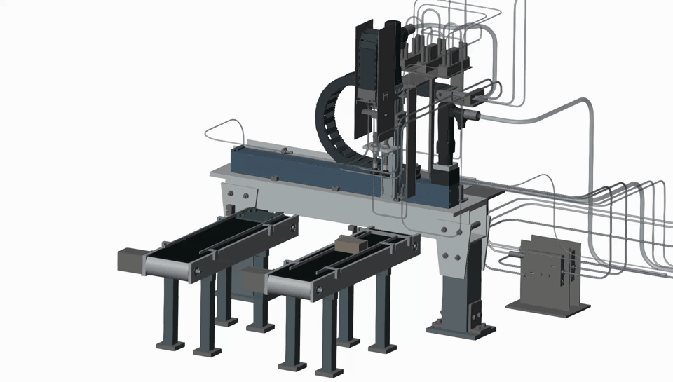

# X–Z Carton Transfer Module

A two-axis packaging module transfers a filled carton from an indexed infeed conveyor to a locating carrier on a second conveyor. The project combines a Creo assembly with a force-driven Simscape Multibody model, servo control and automatic sequencing.

*Optimised automatic cycle recorded from the integrated Simscape Multibody visualisation.*

[Detailed technical report (PDF)](docs/XZ_Carton_Transfer_Detailed_Report.pdf)

## Engineering approach

The stations are 400 mm apart and the carton is lifted 150 mm. A toothed-belt axis provides horizontal travel, a ball-screw axis positions the vacuum tool vertically, and two compliant suction cups grip the carton. Joint feedback and feedforward regulate axis motion. The supervisor checks conveyor registration, grip, support and release before advancing the cycle.

Axis motion and settling accounted for 76.6% of the baseline cycle. The optimised sequence uses jerk-limited profiles during free travel and slower commands near contact. The path, conveyor logic and acceptance limits are retained.

## Simulation results

| Metric at 0.25 kg | Baseline | Optimised |
|---|---:|---:|
| Mean deposit-to-deposit interval | 13.003 s | 10.322 s |
| Simulated throughput | 4.61 cartons/min | 5.81 cartons/min |
| Accepted deposits / returns to ready | 20 / 20 | 20 / 20 |
| Recorded faults / force-saturated samples | 0 / 0 | 0 / 0 |

The mean cycle time decreased by **20.61%** over 19 complete deposit-to-deposit intervals per configuration. The measured final-approach speed reached 9.259 mm/s against a 10 mm/s simulation criterion. The report documents endpoint payload checks, vacuum sensitivity and functional fault scenarios. Physical placement, suction and drive duty require hardware verification.

## Requirements

- MATLAB R2025b with Simulink, Simscape and Simscape Multibody for simulation and visualisation.
- Creo Parametric 10.0.10.0 Educational Edition was used for the native assembly. Opening the native files requires a compatible Creo installation and entitlement.

## Run either cycle in MATLAB

1. Extract the package and set MATLAB **Current Folder** to the directory containing open_carton_transfer.m.
2. To open the optimised model, enter:

~~~matlab
open_carton_transfer
~~~

3. To open the baseline, enter:

~~~matlab
open_carton_transfer('baseline')
~~~

4. The launcher prepares the articulated cable carriers, updates the model and opens Multibody Explorer. Click **Run** in Simulink to animate the cycle. The two variants use the same internal model name. Save or close a modified model before switching.

The nominal demo uses a 0.25 kg carton. The optimised run stops at 10.45 s, matching the recorded video. The baseline stops at 13.05 s, after its first return to ready at 13.021 s. These are demo horizons. The comparison table uses mean deposit-to-deposit intervals from the repeated runs.

The launcher replaces the fixed carrier display with 22 articulated links on X and 20 on Z. Each carrier is driven by the matching nominal X/Z trajectory. This is a visual overlay for the supplied payload and timings. The links do not apply forces to the controlled axes. If you change the recipe or payload, regenerate the carrier motion inputs before using the overlay.

Keep the model folders, their paired DataFiles and the shared STEP files in their supplied locations. The timings reported above were calculated from repeated runs at 0.25 kg using the protocol in the report.

## Open the complete Creo assembly

1. Start a fresh Creo session and set **Working Directory** to the supplied cad folder.
2. In **File → Options → Configuration Editor**, import release_session.pro into the current session. Its relative component search path is ./components.
3. Open xz_packaging_module.asm from the cad folder and regenerate with **Ctrl+G**.
4. Select the saved orientation **MACHINE_OVERVIEW** for the assembly overview.

The numbered Creo file suffixes are part of the native files. Keep cad/components alongside the root assembly.

## Package layout

| Path | Contents |
|---|---|
| open_carton_transfer.m | Entry point for both visual Simulink models |
| cad/ | Native Creo assembly, session configuration and referenced components |
| matlab/models/baseline/ | Baseline visual model and paired DataFile |
| matlab/models/optimised/ | Optimised visual model and paired DataFile |
| matlab/import/ | STEP geometry shared by both models |
| matlab/visualisation/ | Articulated carrier preparation, link geometry and nominal motion inputs |
| docs/ | Detailed report and component provenance |
| media/ | GIF converted from the Simscape recording |

## Component provenance

The frame, brackets, tool supports and conveyor representations were developed for this project. Supplier CAD was downloaded and integrated for the catalogue components below. The STEP geometry used in Simscape includes derivatives of those integrated models.

| Supplier | Main components | CAD source |
|---|---|---|
| Festo | [ELGC-TB horizontal axis (8062778)](https://www.festo.com/us/en/a/8062778), [ELGC-BS vertical axis (8061485)](https://www.festo.com/us/en/a/8061485), angle and drive kits, EMMT-AS motors, EMGA reducer and OVEM vacuum generator | [Festo CAD service](https://cad.festo.com/faq/) and [Festo product catalogue](https://www.festo.com/us/en/a/8062778), with CADENAS terms referenced by the downloads |
| igus | [Series 07](https://www.igus.com/us/pdf/s07.pdf) and [Series 1500](https://www.igus.com/product/series-1500) cable carriers and Series 06 end brackets | [igus PARTcommunity](https://igus.partcommunity.com/) and [TraceParts bracket catalogue](https://www.traceparts.com/en/product/igus-energy-chainr-mounting-bracket-0605012a1?Product=30-30102024-114361&PartNumber=060.50.12.A1) |
| Schmalz | [FSTE plunger (10.01.02.00602)](https://media.schmalz.com/MAM_Library/Dokumente/Datenblatt_Artikel/1/100/10010200602/4559d4532b60_Datasheet_Article_10.01.02.00602_en-EN.pdf), [SC040 connector (10.01.06.02482)](https://media.schmalz.com/MAM_Library/Dokumente/Datenblatt_Artikel/1/100/10010602482/2cb4936812a4_Datasheet_Article_10.01.06.02482_en-EN.pdf) and [SPB1 cup (10.01.06.02453)](https://media.schmalz.com/MAM_Library/Dokumente/Datenblatt_Artikel/1/100/10010602453/64d466673e5f_Datasheet_Article_10.01.06.02453_en-EN.pdf) | [Schmalz catalogue on TraceParts](https://www.traceparts.com/els/schmalz/it/product/schmalz-bellows-suction-pad-round?Product=33-16052019-071613&PartNumber=10.01.06.02453&configuratorType=table) |

See [third-party notices](docs/THIRD_PARTY_NOTICES.md) for article references and the terms associated with the downloads. Supplier names identify component sources. Redistribution requires the applicable rights.

## Author

Francesco De Tursi · MSc student in Mechanical Engineering, University of Bologna  
[LinkedIn](https://www.linkedin.com/in/francescodetursi/) · [GitHub](https://github.com/francesco-detursi)
